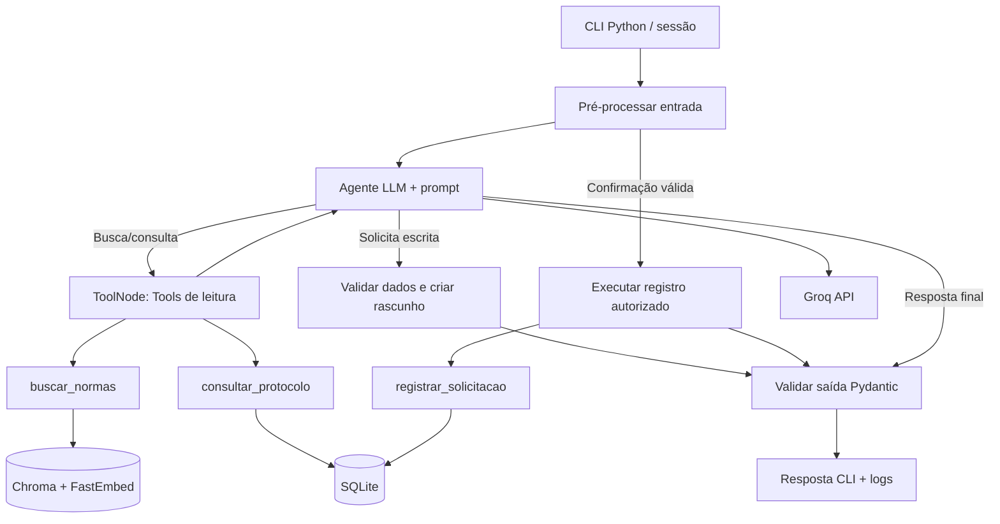
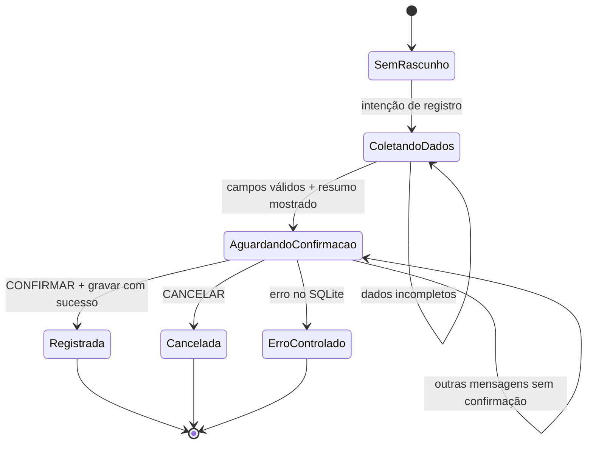

# Arquitetura — desenho executável do sistema (v0.1)

## 1. Stack aprovada

| Camada | Escolha inicial | Justificativa / ressalva |
|---|---|---|
| Linguagem | Python 3.12 | Melhor cobertura do ecossistema do trabalho |
| Interface | CLI interativo | Permitido pelo enunciado; elimina complexidade de UI |
| Provedor LLM | Groq API | Remoto; conta/cota devem ser verificadas; sem dependência de GPU |
| Modelo inicial | `openai/gpt-oss-120b` | Tool Calling documentado; teste de integração obrigatório antes do desenvolvimento amplo |
| LangChain | `langchain-core`, `langchain-groq`, `langchain-community`, `langchain-chroma` | Tools, ChatGroq, embeddings e armazenamento |
| Orquestração | `langgraph` | StateGraph explícito e nós condicionais |
| Embeddings | `fastembed` + `sentence-transformers/paraphrase-multilingual-MiniLM-L12-v2` | Multilíngue, suporte verificado; download local inicial |
| Vetores | Chroma, diretório local persistente | 12 documentos; sem servidor separado |
| Negócio | SQLite via `sqlite3` padrão | Registros e consulta auditáveis |
| Validação | Pydantic v2 | Schemas de Tool, saída e configuração |
| Testes | pytest | Unidade, integração e cenários reais |
| Ambiente | venv + pip no VS Code | Simplicidade e reprodução |

**Nota sobre versões:** não escolher versões exatas sem instalação e smoke test. Ao concluir TSK-002, gravar versões compatíveis em `requirements.txt` e registrar `python --version` + `pip freeze` nas evidências. Se o suporte do modelo mudar, fazer um ADR e testar substituto com Tool Calling. Os nomes aqui descrevem o alvo inicial, não disponibilidade contratualmente garantida.

## 2. Componentes e dependências



O diagrama representa caminhos **lógicos**. A implementação pode distribuir nós de maneira ligeiramente diferente se preservar os controles exigidos e demonstrar as transições nos testes.

## 3. Fluxos principais

### 3.1. Pergunta normativa

1. Receber pergunta; preparar estado.
2. O agente determina que precisa de fonte e aciona `buscar_normas`.
3. O backend consulta embeddings no Chroma, retorna passagens com metadados e registra os IDs.
4. O agente usa somente as passagens recebidas para compor a resposta.
5. Validador verifica schema, fonte presente nos resultados e suficiência de evidência. Se não houver suporte, responde `sem_evidencia`.
6. A CLI imprime resposta, status e fontes; logs registram a busca.

### 3.2. Consulta de protocolo

1. Extrair/validar número `SOL-nnnn`.
2. Acionar `consultar_protocolo`; ler banco.
3. Exibir status **encontrado no banco**, ou `protocolo_nao_encontrado`.
4. A resposta não usa o modelo como fonte do status.

### 3.3. Nova solicitação — duas etapas

1. Usuário solicita abertura. Se faltam campos, agente pergunta pelos campos ausentes e nada é persistido.
2. Com dados completos, o sistema guarda rascunho em sessão, mostra resumo e diz: `Digite CONFIRMAR para registrar ou CANCELAR para desistir.`
3. Próxima mensagem entra pelo nó confiável de pré-processamento: `CONFIRMAR` deve corresponder a rascunho pendente completo; `CANCELAR` descarta rascunho.
4. **Somente nessa condição** o nó controlado pelo backend invoca `registrar_solicitacao` tipada e defensivamente autorizada.
5. SQLite confirma transação; resposta `registrada` apresenta protocolo real. Uma nova `CONFIRMAR` sem rascunho não repete a ação.
6. Se erro/transação falhar, resposta não afirma que registro foi criado.

### 3.4. Perguntas fora da base / solicitações indevidas

- Pergunta sem respaldo (T09) -> `sem_evidencia`; jamais inventar montante da bolsa.
- Pedido de alteração de nota (T10) -> `recusada`; não há Tool desse tipo nem comando SQL correspondente.
- Instruções adversariais dentro de mensagens ou documentos não mudam as regras de autorização.

## 4. Máquina de estados de solicitação



**Importante:** o LLM não pode produzir autorização válida apenas escrevendo `confirmado=true` em argumentos. A decisão de confirmação é capturada pelo backend a partir da **mensagem do usuário**, no contexto de um rascunho pendente.

## 5. Organização proposta de código (alvo após implementação)

```text
instituto-horizonte-agente/
├── AGENTS.md
├── README.md
├── .env.example                   # criar na TSK-002
├── .gitignore                     # criar na TSK-002
├── requirements.txt               # criar e fixar após smoke test
├── data/
│   ├── base_conhecimento_academica.json
│   └── cenarios_de_teste_aluno.csv
├── docs/
│   ├── 00_INTENCAO.md
│   ├── 01_ESPECIFICACAO.md
│   ├── 02_ARQUITETURA.md
│   ├── 03_PLANO.md
│   ├── 04_TAREFAS.md
│   ├── 05_TESTES_E_ACEITE.md
│   └── 06_ADR.md
├── src/instituto_horizonte/
│   ├── __init__.py
│   ├── cli.py
│   ├── config.py
│   ├── schemas.py
│   ├── prompts.py
│   ├── graph.py
│   ├── ingest.py
│   ├── retrieval.py
│   ├── storage.py
│   ├── safety.py
│   ├── logging_utils.py
│   └── tools/
│       ├── normas.py
│       ├── protocolos.py
│       └── solicitacoes.py
├── scripts/
│   ├── init_db.py
│   ├── index_documents.py
│   ├── smoke_test_llm.py
│   └── run_scenarios.py
├── tests/
│   ├── fixtures/
│   ├── test_retrieval.py
│   ├── test_tools.py
│   ├── test_authorization.py
│   ├── test_graph.py
│   └── test_scenarios.py
└── artifacts/                       # logs/relatórios locais, sem credenciais
```

Somente a documentação e os dois arquivos oficiais de `data/` estão incluídos nesta entrega inicial. Arquivos de implementação aparecem a partir das Tasks.

## 6. Indexação reprodutível

- Validar se há exatamente 12 documentos e se `id`/`fonte` são únicos, entre `ACAD-001` e `ACAD-012`.
- Usar o conteúdo literal do campo `conteudo`, prefixado opcionalmente por título/categoria; salvar IDs originais como metadados.
- Gerar embeddings com o mesmo modelo e parâmetros usados na consulta.
- Persistir coleção Chroma no disco e indexar com IDs estáveis; reexecução não duplica vetores (upsert ou recriação controlada somente do índice).
- Ao mudar o modelo de embeddings, identificar mudança de dimensionalidade e recriar a coleção de maneira explícita, não misturar embeddings incompatíveis.
- Exibir na saída da ingestão quantidade indexada e metadados dos 12 documentos.
- Calibrar `top_k` e critérios de relevância com T01–T03, T06–T09; não inventar um threshold a priori.

## 7. Configurações previstas

Arquivo `.env.example` (criado na implementação):

```dotenv
GROQ_API_KEY=
GROQ_MODEL=openai/gpt-oss-120b
EMBEDDING_MODEL=sentence-transformers/paraphrase-multilingual-MiniLM-L12-v2
CHROMA_DIR=.local/chroma
SQLITE_PATH=.local/protocolos.sqlite3
RAG_TOP_K=3
MAX_AGENT_ROUNDS=6
LOG_DIR=artifacts/logs
```

A `.env` real, `.local/`, ambientes virtuais e arquivos de log com conteúdo potencialmente sensível devem ficar fora do controle de versão.

## 8. Observabilidade e evidência

Cada evento JSONL sugerido: `timestamp_utc`, `run_id`, `session_id`, `turn_id`, `node`, `evento`, `tool_name`, `args_resumo`, `resultado_resumo`, `fonte_ids`, `duracao_ms`, `erro_tipo`, `fim_motivo`. Nunca gravar `GROQ_API_KEY`, credenciais digitadas, mensagens brutas sensíveis, tokens nem cabeçalhos privados.

Dois relatórios distintos:

1. **Unitários com mocks:** verificam roteamento, contratos, falhas e autorizações; não demonstram integração externa.
2. **Execuções reais:** registram chamadas reais ao LLM, consultas ao índice e Tools, entrada original de cada cenário, saída observada e classificação manual fundamentada.

## 9. Links técnicos de referência (consultados em 05/11/2026)

- Groq Tool Use: https://console.groq.com/docs/tool-use/overview
- Groq modelos: https://console.groq.com/docs/models
- `ChatGroq.bind_tools`: https://reference.langchain.com/python/langchain-groq/chat_models/ChatGroq/bind_tools
- `ChatGroq.with_structured_output`: https://reference.langchain.com/python/langchain-groq/chat_models/ChatGroq/with_structured_output
- `ToolNode`: https://docs.langchain.com/oss/python/langgraph/workflows-agents
- FastEmbed modelos suportados: https://qdrant.github.io/fastembed/examples/Supported_Models/
- `FastEmbedEmbeddings`: https://reference.langchain.com/python/langchain-community/embeddings/fastembed/FastEmbedEmbeddings

Usar essas referências na etapa de implementação para confirmar APIs e versões efetivamente instaladas.
