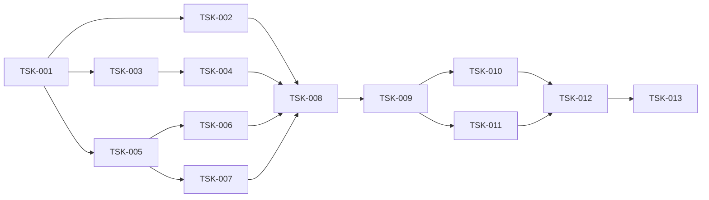

# TASKS — Backlog de implementação e rastreabilidade

**Estados possíveis:** Pendente / Em andamento / Concluída / Bloqueada.  
**Situação inicial:** todas as Tasks de implementação estão Pendentes. SDD/documentação inicial concluída na versão 0.1.

| Task | Escopo | RF vinculados | Teste principal | Estimativa | Estado |
|---|---|---|---|---:|---|
| TSK-001 | Estrutura Python, VS Code, venv, `.env.example`, `.gitignore`, config | RNF-01/02/06 | Instalação limpa e config inválida | 1–2h | Concluída |
| TSK-002 | Smoke test Groq: Tool Calling + saída Pydantic, erros e versões | RF-08/09 | Chamada real + teste sem chave | 1–2h | Concluída |
| TSK-003 | Loader/validação de 12 registros JSON e indexação idempotente | RF-01/02 | 12 IDs únicos e metadata | 1–2h | Concluída |
| TSK-004 | Chroma/FastEmbed + `buscar_normas`, logs de retrieval | RF-01/02/03/09 | T01–T03/T06–T09 | 2–3h | Concluída |
| TSK-005 | SQLite e seed reexecutável para SOL-1001 | RF-04/06 | Consulta SQL e seed duplicado | 1–2h | Concluída |
| TSK-006 | `consultar_protocolo` tipada e estados de erro | RF-04/09 | T04 + ID inexistente | 1–2h | Concluída |
| TSK-007 | `registrar_solicitacao` com validação, autorização e idempotência | RF-05/06/07/09/13–15 | Fluxo confirmação e negação | 2–4h | Concluída |
| TSK-008 | `StateGraph`, rotas, sessão e ciclo de Tools | RF-01/04/05/09/10 | T01/T04/T05 | 3–5h | Em andamento |
| TSK-009 | Structured Output, validador pós-resposta, segurança e limites | RF-03/07/08/10 | T09/T10 + schema inválido | 2–3h | Pendente |
| TSK-010 | CLI interativa com retorno explícito de fontes/status/protocolo | RF-01/04/06/08 | Demonstração manual | 1h | Pendente |
| TSK-011 | Logs auditáveis, falhas 429/timeout e tratamento de erros | RF-11 | Teste de injeção de falhas | 1–2h | Pendente |
| TSK-012 | Suite unitária e de integração, harness dos 10 cenários originais | RF-12 | `pytest` + script cenários | 3–5h | Pendente |
| TSK-013 | README, evidências reais, relatório e reflexão sobre uso de IA | RF-11/12 | Checklist docente + reproduzir | 2–3h | Pendente |

### Critério obrigatório da TSK-008

A transição de confirmação no LangGraph deve aceitar `CONFIRMAR` somente quando recebido em uma **nova mensagem do usuário**, posterior à apresentação do resumo e associado ao rascunho pendente correto. Decisão, Tool Call, texto ou resposta gerados pelo LLM não constituem consentimento e não podem autorizar escrita.

**Observação de estimativa:** a soma das Tasks é uma decomposição para planejamento, não um cronograma rígido. Reserva global de 24–36 horas contempla integração e correções.

## Dependências

## A primeira solicitação ao Codex

Depois de abrir este repositório no VS Code, executar **apenas TSK-001**, conforme `AGENTS.md` e `docs/07_PROMPT_CODEX.md`. Evitar pedir implementação completa de uma vez.

## Evidências de SDD para bonificação

Para cada Task concluída, registrar em `docs/evidencias_sdd/TSK-nnn.md`:

- Intent/Spec (requisitos e decisão relevante);
- Plano da alteração e arquivos previstos;
- Prompt enviado ao Codex e resumo de contribuição da IA;
- Arquivos efetivamente alterados / resumo do diff;
- Comandos e resultados de testes **executados de verdade**;
- O que o estudante revisou/corrigiu antes de aceitar;
- Commit hash (se houver) e critério de aceite.

Não simular screenshots, logs, chamadas à API, aprovações nem commits.
